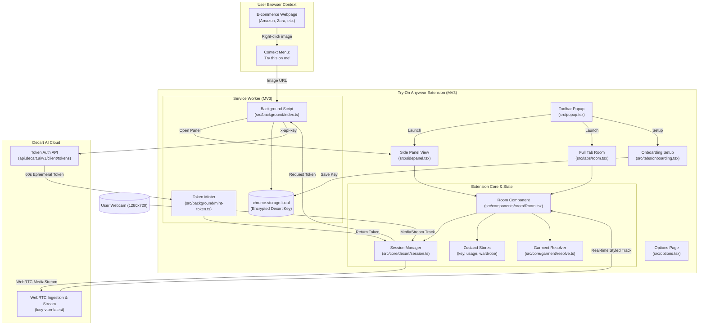

# Try-On Anywear 👗✨

> **Virtual Try-On Room for Any Shopping Site, powered by Decart AI.**

**Try-On Anywear** is a Manifest V3 Chrome Extension that brings real-time, WebRTC-based AI clothing try-on to any e-commerce site (Amazon, Zara, ASOS, Uniqlo, etc.). Powered by Decart's `lucy-vton-latest` model, users can align in front of their webcam, upload or right-click any product image on the web, and see the clothes rendered directly onto their live video feed.

---

## 🌟 Key Features

- **⚡ Real-Time WebRTC Streaming:** Live 30 FPS video try-on directly from your camera using `@decartai/sdk` (`lucy-vton-latest`).
- **🪟 Chrome Side Panel & Full Tab Room:** Use the convenient slide-out Chrome Side Panel alongside any shopping website, or open the full try-on stage in a dedicated tab.
- **🖱️ "Try this on me" Context Menu:** Right-click any clothing image on any website to immediately load it into your try-on session.
- **🔒 Zero-Leak Security Architecture:** Your permanent Decart API key never leaves local extension storage (`chrome.storage.local`). The background service worker mints short-lived (60s) client tokens for streaming sessions.
- **⏱️ Real-Time Usage Tracking:** Live counter displays generated seconds used during your session for complete billing transparency.
- **📸 Interactive Controls:**
  - **Hold to Compare:** Instant preview toggle between your raw webcam feed and the AI styled feed.
  - **Snapshot:** One-click instant HD capture of your try-on outfit.
  - **Fast Mode Toggle:** Lower latency switch for accelerated throughput.
  - **Wardrobe History:** Quick carousel of garments tried during the current session with atomic swapping.

---

## 🏗️ Architecture



### Security & Token Minting Lifecycle
1. The user stores their permanent Decart API key during onboarding. It is saved strictly inside `chrome.storage.local`.
2. Pages (Room tab, Side panel, or external web scripts) **never** have access to the permanent API key.
3. When establishing a WebRTC session, the client asks the background service worker for a credential.
4. The service worker calls `https://api.decart.ai/v1/client/tokens` with `x-api-key` to mint a **60-second single-purpose client token**.
5. Only this ephemeral token is passed to the WebRTC connection, preventing credential interception or leakage.

---

## 📁 Project Structure

```text
├── assets/                  # Extension icons (16, 32, 48, 64, 128px)
├── src/
│   ├── background/
│   │   ├── index.ts         # Service worker, context menus, runtime messages
│   │   └── mint-token.ts    # Ephemeral token minting from Decart
│   ├── components/
│   │   ├── room/            # Virtual Room UI
│   │   │   ├── ControlBar.tsx   # Snapshot, mirror, fast-mode, hold-to-compare
│   │   │   ├── LaserScan.tsx    # Connecting animation
│   │   │   ├── PersonGuide.tsx  # Alignment overlay guides
│   │   │   ├── Room.tsx         # Main stage coordinator & WebRTC session hook
│   │   │   ├── Stage.tsx        # Video canvas & comparison view
│   │   │   └── StatusChip.tsx   # Session status indicator
│   │   └── ui.tsx           # Button, Card, Chip, Spinner components
│   ├── core/
│   │   ├── decart/
│   │   │   ├── client.ts    # Decart SDK client initialization
│   │   │   ├── errors.ts    # Error mapping & troubleshooting guide
│   │   │   └── session.ts   # WebRTC session management & track swap
│   │   └── garment/
│   │       ├── prompt.ts    # Regional VTON prompt builder
│   │       └── resolve.ts   # Image blob & garment normalization
│   ├── store/
│   │   ├── key.ts           # Decart API key & fast-mode storage
│   │   ├── usage.ts         # Session duration & credit tracker
│   │   └── wardrobe.ts      # Active wardrobe state (up to 12 items)
│   ├── tabs/
│   │   ├── onboarding.tsx   # 3-step setup (Key, Camera, UDP network check)
│   │   └── room.tsx         # Full-tab room page
│   ├── options.tsx          # Settings page
│   ├── popup.tsx            # Quick-action toolbar popup
│   ├── sidepanel.tsx        # Chrome Side Panel entry point
│   ├── style.css            # Tailwind CSS styling
│   └── types.ts             # TypeScript interfaces (Garment, Region, etc.)
├── package.json             # Plasmo manifest config & dependencies
├── tailwind.config.js       # UI theme configuration
└── tsconfig.json            # TypeScript configuration
```

---

## 🚀 Getting Started

### Prerequisites

- [Node.js](https://nodejs.org/) (version 18 or later)
- [pnpm](https://pnpm.io/) (version 9 or later)
  ```bash
  npm install -g pnpm
  ```
- A **[Decart AI](https://decart.ai)** account and API key.

---

### Installation

1. **Clone the repository:**
   ```bash
   git clone https://github.com/your-username/tryon-anywear.git
   cd "tryon-anywear"
   ```

2. **Install dependencies:**
   ```bash
   pnpm install
   ```
   *(Note: A postinstall script automatically configures Zod for bundle compatibility).*

---

### Build Commands

| Command | Description |
| :--- | :--- |
| `pnpm run build` | Builds the optimized production extension into `build/chrome-mv3-prod`. |
| `pnpm run dev` | Runs the development live-reload server into `build/chrome-mv3-dev`. |
| `pnpm run typecheck` | Validates TypeScript types across the entire project with `tsc --noEmit`. |
| `pnpm run package` | Packages the built extension into a `.zip` archive ready for the Chrome Web Store. |

---

## 🧩 Loading into Chrome / Edge / Brave

1. Run the build command:
   ```bash
   pnpm run build
   ```
2. Open your browser and navigate to the extensions page:
   - **Google Chrome / Brave:** `chrome://extensions`
   - **Microsoft Edge:** `edge://extensions`
3. Enable **Developer mode** (toggle in the top-right corner).
4. Click **Load unpacked** (top-left).
5. Select the project build directory:
   ```text
   <path-to-project>/build/chrome-mv3-prod
   ```
6. Click the **Puzzle icon (🧩)** on your browser toolbar and click **Pin (📌)** next to **Try-On Anywear**.

---

## 📖 How to Use

### 1. One-Time Setup (Onboarding)
- Click the pinned **Try-On Anywear** icon in your toolbar and select **Add Decart API Key / Setup** (or navigate to `chrome-extension://<EXTENSION-ID>/tabs/onboarding.html`).
- **Step 1:** Paste your Decart API key (`dct_...`) and click **Validate & Save**. A 60-second live test token will be minted to verify access.
- **Step 2:** Click **Allow camera** to grant local webcam access for the extension origin.
- **Step 3:** Click **Run check** to verify UDP WebRTC connectivity to Decart servers.

### 2. Virtual Try-On Stage
- **Option A (Side Panel):** Click **Open Side Panel** from the toolbar popup while viewing any shopping site.
- **Option B (Full Tab):** Click **Open Try-On Room (Full Tab)**.
- Stand in front of your camera and align with the torso outline.
- Click **+ Try on** to upload a clothing photo, or use the context menu.

### 3. Shopping Site Integration ("Try this on me")
1. Browse any clothing site (Zara, ASOS, Uniqlo, Amazon, etc.).
2. Right-click on any model or product clothing image.
3. Select **"Try this on me"** from the context menu.
4. The Side Panel will automatically launch and stream the garment onto your live webcam feed!

---

## 🛠️ Tech Stack

- **Framework:** [Plasmo](https://docs.plasmo.com/) (Browser Extension Framework for MV3)
- **UI & Styling:** [React 18](https://react.dev/), [Tailwind CSS](https://tailwindcss.com/)
- **State Management:** [Zustand 5](https://github.com/pmndrs/zustand)
- **AI & WebRTC Engine:** [`@decartai/sdk`](https://github.com/DecartAI/sdk) (`lucy-vton-latest`)
- **Storage:** [`@plasmohq/storage`](https://docs.plasmo.com/framework/storage)

---

## 📄 License

This project is licensed under the [MIT License](LICENSE).
